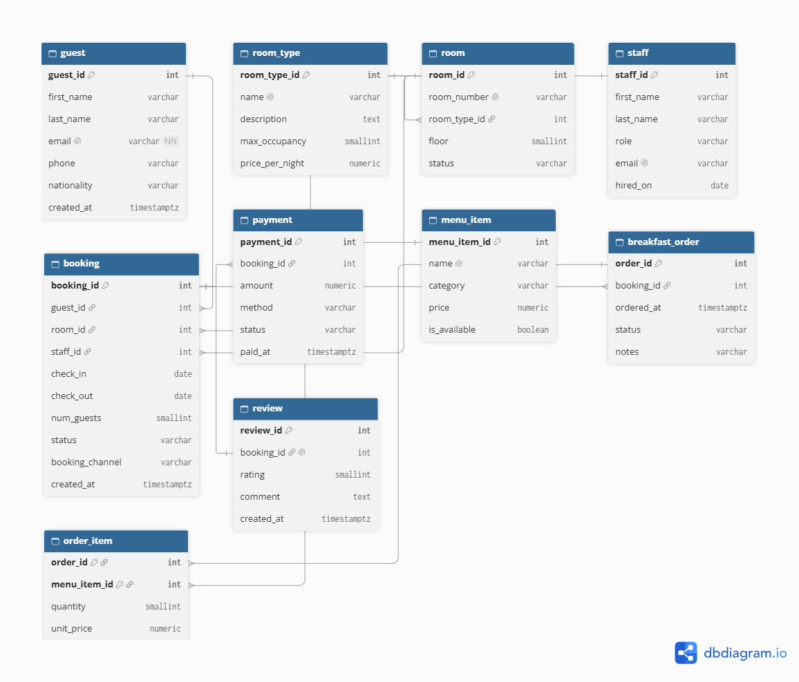

# Portfolio 1 — Database Design and Modelling

## Case study
(2–3 sentences on Retiro Resort and what the database supports)

## ER diagram

## Entities and relationships
(Table: entity, primary key, foreign keys, purpose — use the table in Lab 1.1)
Cardinalities: guest 1:N booking; room 1:N booking; room_type 1:N room;
booking 1:N payment; booking 1:N breakfast_order; breakfast_order M:N menu_item via order_item;
booking 1:1 review (UNIQUE booking_id).

## Keys and constraints
(Explain each type with one example from the schema: PK, surrogate vs natural key,
alternate key, FK with RESTRICT/CASCADE/SET NULL, composite key, CHECK, DEFAULT,
and the EXCLUDE constraint.)

## Normalisation
### Starting point: the front desk's paper booking sheet (unnormalised)
| BookingNo | GuestName | GuestPhone | RoomNo | RoomType | Price | CheckIn | CheckOut | BreakfastItems |
|---|---|---|---|---|---|---|---|---|
| 1 | Adaeze Okafor | 0803... | 101 | Standard | 45000 | 2026-10-02 | 2026-10-05 | Akara & Pap x2, Tea x2 |

### 1NF — atomic values
BreakfastItems holds a list → split into separate rows/table (order_item).
### 2NF — no partial dependencies
In (order_id, menu_item_id, item_name), item_name depends only on menu_item_id → moved to menu_item.
### 3NF — no transitive dependencies
RoomNo → RoomType → Price. Price depends on the type, not the room → moved to room_type.
Guest name/phone depend on the guest, not the booking → moved to guest.
### Anomalies this prevents
(Update, insert and delete anomaly — one Retiro example each.)
### Deliberate decision: order_item.unit_price
(Why storing the historical price is correct and not a 3NF violation.)

## How to run
psql -U postgres -d retiro -f 01_schema.sql
psql -U postgres -d retiro -f 02_seed_data.sql
psql -U postgres -d retiro -f 03_constraint_tests.sql

## Evidence
(Screenshots: seed counts, constraint errors, ER diagram)